# Wireframe notes

Low-fidelity Android wireframes A to P, with the three notes that appear beside each one in the submission deck. Evidence tags: [D] documented by Agoda, [A] Voya assumption or design decision, [V] needs validation with Agoda. All hotels, prices, dates and IDs are invented test data.

## A. My trips

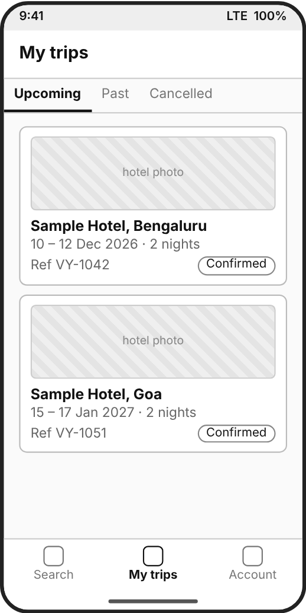

- **Design (UI/UX):** Upcoming trips come first. Each card carries hotel, dates, Voya reference and status so the right booking is easy to pick. Cancelled trips have their own tab.
- **Developer (API):** [A] The list is read from Voya's own booking table, which stores Agoda's bookingId next to the Voya reference. [D] Booking List can look up bookings by recent window or partner tag, so Voya uses it to reconcile missing records, not to build this screen.
- **Business:** [A] Cancelling starts from a screen travelers already use. Because Voya owns the record, trips still show if Agoda is slow or unreachable.

## B. Booking details

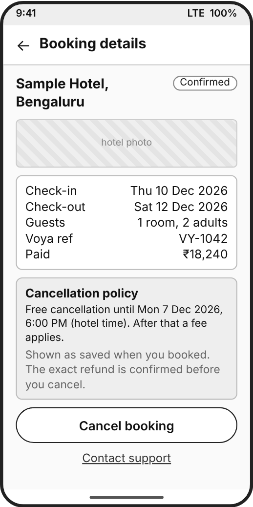

- **Design (UI/UX):** Cancel booking is an outlined button, not red; red appears only on the final confirm. The policy and Contact support sit on the same screen.
- **Developer (API):** [D] Booking Detail gives status (BookingConfirmed here), the text cancellationPolicy and isFeeWaiverAllowed. [D] Search cancellationDetail, saved at booking, is the structured policy behind the reminder. [A] Cancel shows only when the status allows it.
- **Business:** The policy line reminds travelers of the deadline before they ask for a refund. It is a reminder only; the amount comes from Preview on the next step.

## C. Preview loading

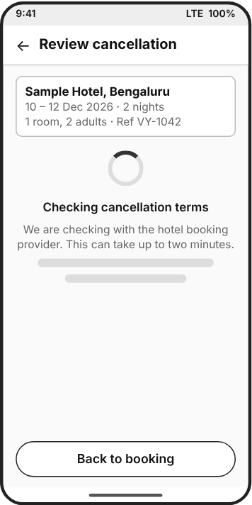

- **Design (UI/UX):** Hotel and dates appear at once, then a plain waiting message. No countdown, since we do not know how long it will take. Back to booking stays available.
- **Developer (API):** [D] Cancel Preview takes {bookingId} and may take up to 120 seconds. [A] The backend owns the wait and keeps the request state, so closing the app does not restart it.
- **Business:** No amount is shown until Agoda answers. A guessed refund would be a promise Voya may not be able to keep.

## D. Preview, full refund (VY-1042)

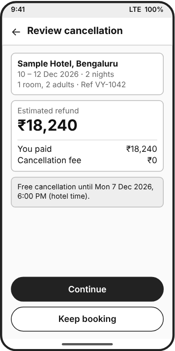

- **Design (UI/UX):** Estimated refund is the largest figure and sits above Continue. Keep booking has equal weight so leaving is easy.
- **Developer (API):** [D] Preview returns cancellationSummary with refundRate, paymentRate, reference and cancellationPolicy. Store reference and refundRate for Confirm; do not recompute them on the phone. [A] Paid equals refund here only because we assume price parity.
- **Business:** [A/V] Assumes Voya refunds what Agoda quotes. A Voya fee, coupon or currency difference must be settled before the traveler confirms.

## E. Preview, partial refund (VY-1057)

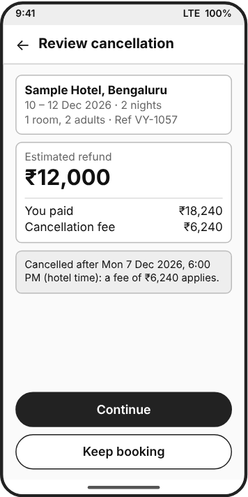

- **Design (UI/UX):** Same layout as the full-refund state, so travelers learn it once. Fee and refund are separate lines so the loss is visible before Continue.
- **Developer (API):** [D] refundRate is lower than paymentRate. The fee line is the difference, computed for display only [A]. cancellationPolicy text explains why. Fixture VY-1057 with a simulated date after the penalty cutoff.
- **Business:** [A] ₹12,000 is an invented test value. Voya shows the quote as given; disputes go to support, not into this flow.

## F. Preview, no refund (VY-1063)

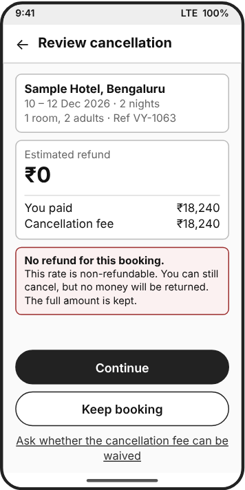

- **Design (UI/UX):** The screen says plainly that no money returns. Continue stays enabled because cancelling is still allowed. The waiver link appears only when it is permitted.
- **Developer (API):** [D] refundRate of 0 can still be confirmed with the same Confirm call. [D] The waiver link needs isFeeWaiverAllowed from Booking Detail, plus account permission [V]. Fixture VY-1063.
- **Business:** Showing ₹0 before Continue avoids a complaint after the fact. A zero refund is not the same as a booking that cannot be cancelled.

## G. Reason and final review

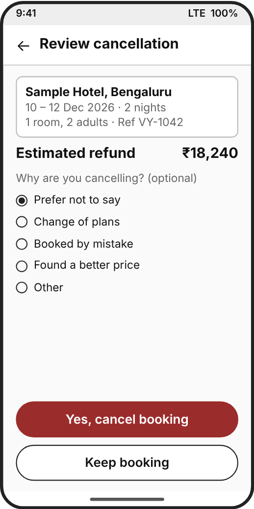

- **Design (UI/UX):** Reason is optional and defaults to Prefer not to say. Hotel, dates and refund repeat so the wrong stay is not cancelled. Yes, cancel booking is the only red button; Keep booking sits right under it. No biometric prompt.
- **Developer (API):** [D] Confirm body: bookingId, reference, cancelReason, remark (optional) and refundRate {currency, inclusive}, copied from the latest Preview. Send cancelReason 0 when skipped; use only documented values. [A] Button disables on tap.
- **Business:** Reason data is useful later and never blocks cancelling. [A] Voya's own request deduplication stops double taps; it does not make Agoda's Confirm exactly-once.

## H. Sending progress

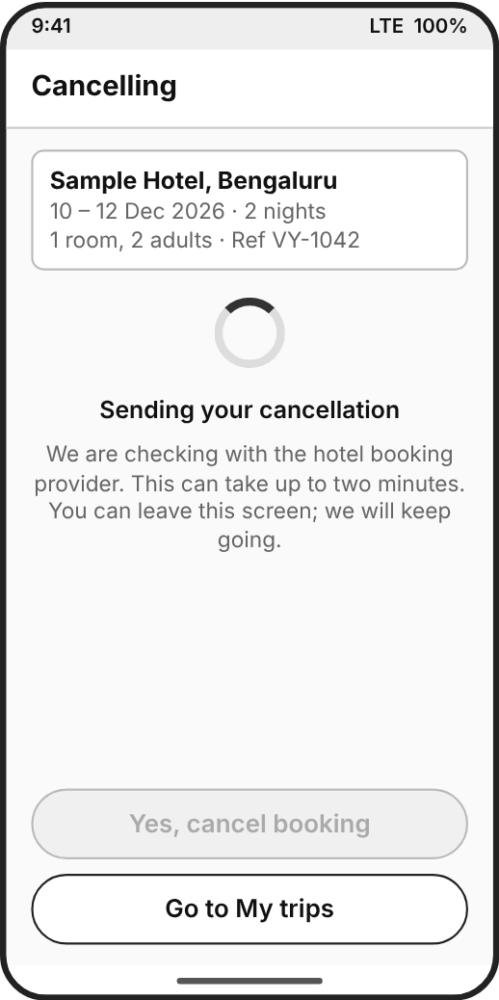

- **Design (UI/UX):** Says which step is running, blocks a second tap and lets the traveler leave. The final button stays visible but disabled so nothing seems to have vanished.
- **Developer (API):** [D] Confirm may take up to 120 seconds. [A] The backend records that Confirm was sent before the call, so a closed app can recover by reading Booking Detail.
- **Business:** The backend, not the screen, owns the request. A traveler who leaves cannot trigger a second cancellation.

## I. Cancellation confirmed

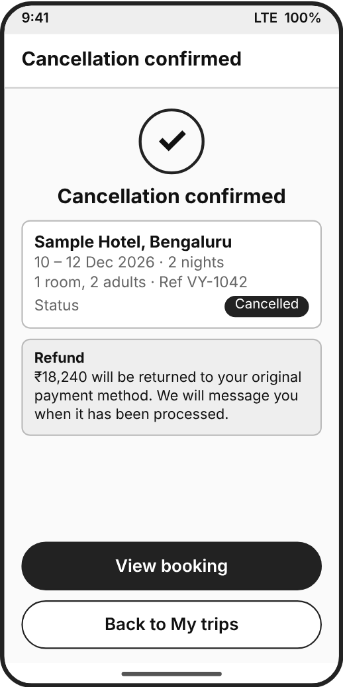

- **Design (UI/UX):** The headline says Cancelled and repeats hotel, dates and reference. Refund wording gives no number of days. View booking opens the cancelled record.
- **Developer (API):** [D] A successful Confirm is HTTP 200 with an empty body. Voya then reads Booking Detail and shows this screen only when the status is cancelled [V: confirm exact status in sandbox].
- **Business:** [A] Cancelling the booking and returning money are separate: the payment gateway sends the refund. Agoda does not document refund timing under Partner Fulfillment [V].

## J. Outcome unknown after a timeout

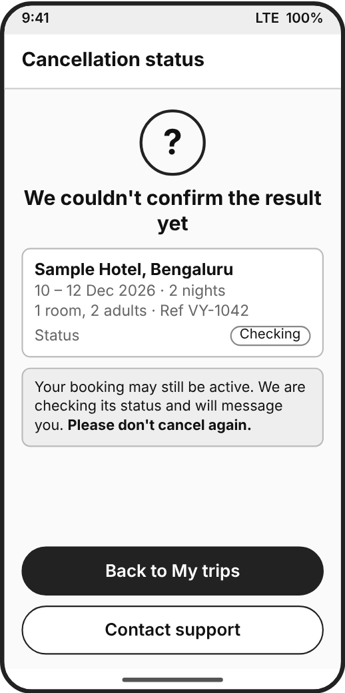

- **Design (UI/UX):** Neither success nor failure. It says the booking may still be active, that we are checking, and asks the traveler not to cancel again. Support is one tap away.
- **Developer (API):** [D] No reply in time does not mean cancelled. The backend reads Booking Detail first and asks for a fresh Preview only if the booking is still active. [A] Traveler is notified when the check finishes.
- **Business:** Prevents duplicate cancellations and false cancelled messages. Support starts with the reference already attached.

## K. Fee waiver request

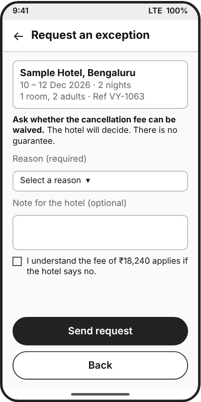

- **Design (UI/UX):** Plain wording that the hotel decides. A required reason, an optional note and a checkbox so the traveler knows the fee stands if the hotel says no.
- **Developer (API):** [D] Confirm with requestingFeeWaiver true, feeWaiverReason and remark, only when isFeeWaiverAllowed. [V] Reason values differ between the guide and the Appendix; account permission may block it (error 924). [A] The cancellation goes with the request.
- **Business:** The hotel carries the decision, not Voya, so copy must not promise a waiver. [V] Who tells the traveler when the answer arrives.

## L. Fee waiver pending

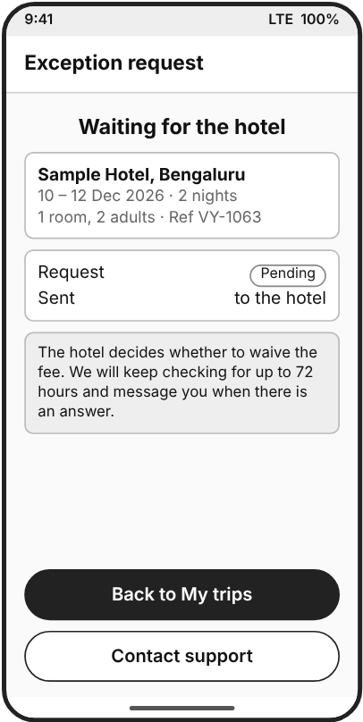

- **Design (UI/UX):** One clear status, Pending, and how long we will keep checking. No progress bar, because the hotel sets the pace.
- **Developer (API):** [D] Poll Booking Detail feeWaiverStatus for up to 72 hours, not past 12:00 AM on the check-in date. Sandbox hotel 42976 stays pending, then accepts after 24 hours. [V] Booking status while pending.
- **Business:** Polling and messages cost engineering time, and the 72-hour limit is documented. Support gets the case if there is no answer.

## M. Fee waiver accepted or declined

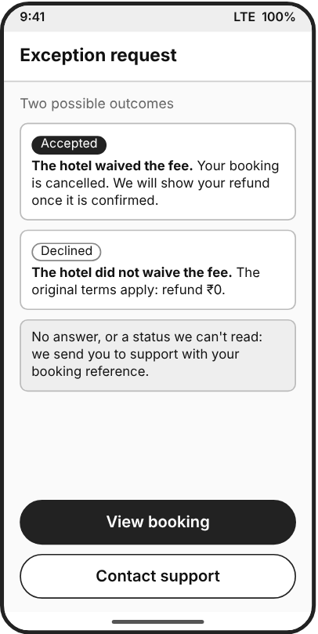

- **Design (UI/UX):** Two outcomes in one panel, each stating what happens next. Accepted: fee waived. Declined: original terms. No celebration styling. Anything unreadable goes to support.
- **Developer (API):** [D] feeWaiverStatus Accept or Reject. [V] The guide also lists Cancelled and AutoReject; the Appendix lists Timeout. Treat those as Ask support. Verify Booking Detail before saying cancelled.
- **Business:** [A] A declined waiver means the original terms stand. Confirm with Agoda that the booking stays cancelled in that case.

## N. Cannot cancel in the app

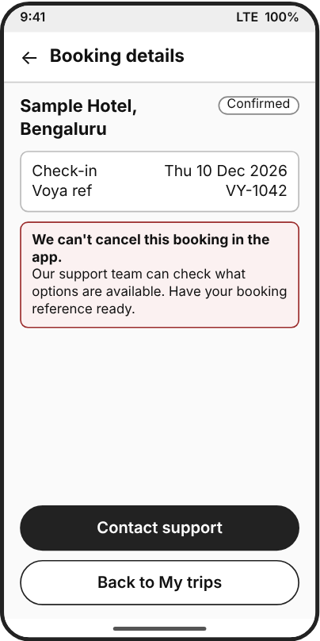

- **Design (UI/UX):** One sentence on what happened and a direct way to reach support. The error code is never shown. The reference is already on screen.
- **Developer (API):** [A] Voya decides assisted cancellation from Booking Detail status or a check-in date too close to the cutoff. [V] The boundary: one day before check-in, or 12:00 AM on the check-in date. Support ticket creation is a design assumption.
- **Business:** Manual cancellations use support time. Settling the cutoff with Agoda decides how many bookings end up here.

## O. Already cancelled

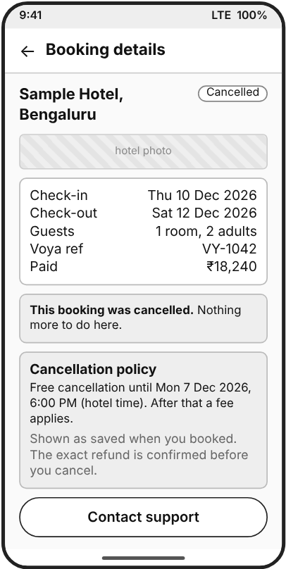

- **Design (UI/UX):** The Cancel button is gone and the status is at the top. Dates and policy remain for reference. Contact support is still there.
- **Developer (API):** [D] Booking Detail status BookingCancelled or BookingCancelledByCustomer means Preview and Confirm are not called. [A] Refund status shown here comes from Voya's own records.
- **Business:** Saves needless API calls and avoids double-cancel confusion.

## P. Could not cancel

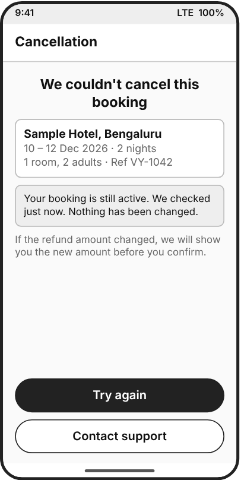

- **Design (UI/UX):** States the booking is still active only because Booking Detail says so. Try again starts over with a new quote; support is the fallback.
- **Developer (API):** [D] Retryable errors (HTTP 500, 429): recheck Booking Detail, then a fresh Preview. Refund mismatch 914: new Preview, show the new amount. Auth or permission errors (102, 401, 403): log, do not loop. [A] Travelers never see codes.
- **Business:** Keeps operations alerts separate from traveler wording. Repeated failures move the booking to the assisted path.
